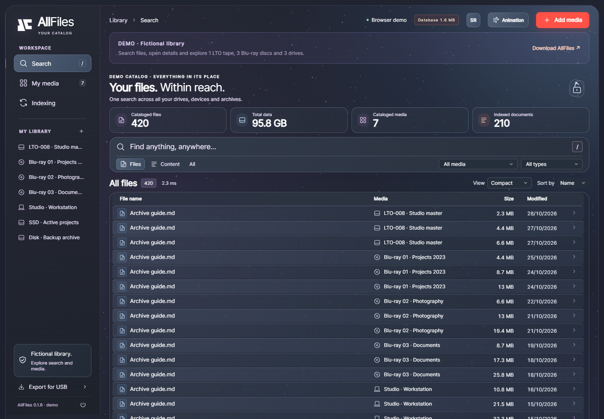

# AllFiles

**Public release 0.1.6** · [Download](https://github.com/vladimirperovic/allfiles/releases/tag/v0.1.6) · [Browser demo](https://vladimirperovic.github.io/allfiles/) · [Documentation](docs/README.md) · [Changes](CHANGELOG.md) · [MIT license](LICENSE)

A portable catalog for files on your computers, external drives, Blu-ray discs and LTO tapes.

[](https://vladimirperovic.github.io/allfiles/)

*Synthetic demo data: 1 LTO tape, 3 Blu-ray media and 3 disks. [Open the interactive browser demo](https://vladimirperovic.github.io/allfiles/).*

One executable opens a local web interface, and your catalog remains searchable when the original media are disconnected. AllFiles stores file metadata and extracted document text; **it does not back up the original files**.

The application is designed for local use, including Omarchy Linux with its data inside a mounted VeraCrypt container. The project targets Linux, Windows and macOS; consult the release for available packages and verified platforms. There is no subscription, required cloud server or bundled AI model. The executable needs no separate Rust, Go, Node, Python or SQLite installation.

## Start the application

Download an available archive for your computer from the [v0.1.6 release](https://github.com/vladimirperovic/allfiles/releases/tag/v0.1.6), verify its SHA-256 checksum against the supplied checksums and extract it into your chosen folder. For Omarchy on an Intel/AMD computer, use `linux-amd64`. Mount your VeraCrypt container first if you use one. Historical 0.2.0 and 0.3.0 tags remain unchanged; their larger version numbers do not make them the current public package.

| System | Release 0.1.6 archive |
|---|---|
| Windows Intel/AMD 64-bit | `allfiles-0.1.6-windows-amd64.zip` |
| Linux Intel/AMD 64-bit | `allfiles-0.1.6-linux-amd64.tar.gz` |
| Linux ARM64 | `allfiles-0.1.6-linux-arm64.tar.gz` |
| macOS Apple Silicon | `allfiles-0.1.6-darwin-arm64.tar.gz` |
| macOS Intel | `allfiles-0.1.6-darwin-amd64.tar.gz` |

The native CI Linux packages target Ubuntu 24.04 and glibc 2.39 or newer. Older systems may require a source build. Download `SHA256SUMS.txt` too and verify the complete archive hash before extraction. Packages are unsigned. Check the release page for actual availability and validation results.

From a terminal in the application's folder:

```sh
chmod +x ./allfiles-linux-amd64
mkdir -p data
./allfiles-linux-amd64 serve --data "$PWD/data"
```

AllFiles prints its local address and opens your browser. It chooses a free port by default. Add `--port 8765` for a fixed port, or `--no-browser` to open the address yourself. `serve` can be omitted. The `--data` directory **must already exist**; the application does not silently put your catalog in your home folder.

The **EN / SR** button switches the web interface between English and Serbian and remembers that choice in the current browser. It does not translate or change your filenames, paths, media labels or document contents. Terminal messages and underlying diagnostics may use English or Serbian independently of that selection.

On Windows, use PowerShell:

```powershell
New-Item -ItemType Directory -Path data -Force | Out-Null
.\allfiles-windows-amd64.exe serve --data "$PWD\data"
```

On an Apple Silicon MacBook Air, use `allfiles-darwin-arm64`; Intel Macs use `allfiles-darwin-amd64`. The Linux commands above also work on macOS after substituting the executable name. Initial builds are unsigned, so Windows or macOS may ask you to allow the downloaded application. Do not disable your system's protection globally.

Stop with `Ctrl+C` or the interface's close-application action, and wait for it to exit before disconnecting storage or dismounting a container. Only one AllFiles process can open a data directory at a time. While the interface is running, use its scan/import/export actions; close it before running the equivalent standalone CLI commands. A remaining `.allfiles.lock` file is normal: its operating-system lock is released when the process exits.

## Storage and portability

```text
allfiles-linux-amd64        executable with the web interface built in
data/
  catalog.sqlite           media, folders, filenames and metadata
  content.sqlite           extracted document text and its search index
  encryption.json          present and required for encrypted catalogs
```

If the content database is missing or does not match the catalog, names and paths remain available. The indexed-document count reflects available content, and the application explains the incomplete copy. Restore the matching content database while the service is closed, or reindex accessible originals; opening an incomplete copy does not erase existing metadata.

The content database is created when needed. Keeping it separate lets you export a smaller metadata-only catalog; separation alone does not guarantee faster searches. Size depends on the number and length of paths, extracted text and search indexes.

This is a local executable with a browser interface, not a standalone `index.html` application. It listens only on `127.0.0.1`. Copy the appropriate executable and an exported data directory to USB to use them on another computer. The database format is shared across supported operating systems; paths to original files may still differ between computers.

## Add files and search

Choose **Add media** in the interface, set a label and physical location, and select a folder available on the current computer. Media kinds are `folder`, `computer`, `external`, `bluray` and `lto`. For example, after closing the running service:

```sh
./allfiles-linux-amd64 scan \
  --data "$PWD/data" \
  --root "/path/to/your/folder" \
  --label "HOME-SSD-01" \
  --kind external \
  --location "Home office shelf" \
  --content
```

Replace the sample path with a real one. Without `--content`, the CLI scan collects metadata only. With it, AllFiles also extracts text from supported documents. A completed rescan removes stale catalog entries for missing files; it never deletes original files. A cancelled or failed scan retains records already processed and does not perform that final stale-entry cleanup.

The folder picker lists up to 2,000 subfolders and shows a notice if more exist. Ordinary files do not consume this limit. Enter the full folder path directly when the desired folder is not listed.

Search filenames/paths or document content, then narrow results by media and file type. Results identify the original location even when its media are offline. Opening the original file requires the media to be available at the recorded path. Scans skip symbolic links and the application's own data directory.

The default **Compact** view uses Explorer-style rows to show more files at once; choose **Comfortable** for larger rows. Full names and paths remain available in tooltips and file details. Results are loaded in bounded pages, with first/last-page controls and a page-number jump for large catalogs.

**My media** provides a compact list, a name/location search and a media-type filter. Switch to cards when you prefer an overview. Use `/` to focus file search, or the keyboard skip link to reach the main workspace without tabbing through every medium.

| Document type | Content indexing |
|---|---|
| PDF with a text layer | Extractable text |
| DOCX, XLSX, PPTX | Text from modern Office XML files |
| ODT, ODS, ODP | OpenDocument text |
| TXT, MD, CSV, TSV, LOG, JSON, XML, HTML/HTM | Text content; HTML is read as text, without execution |
| Image-only scanned PDF | Metadata only; OCR is not included |
| Legacy DOC, XLS, PPT | Metadata only in this version |

Extraction does not reproduce document layout, images or every embedded object. Protected, damaged and unsupported documents remain in the catalog even when text extraction fails. Limits are 256 MiB per input document, 8 MiB of extracted UTF-8 text, 32 MiB per expanded Office XML part, 64 MiB of expanded Office XML in total, and 20,000 PDF pages. File details show when text is truncated. These are not strict memory or time limits for the PDF parser.

An LTO tape must be available as a mounted filesystem or through a supported catalog export. AllFiles does not control a tape drive or decode proprietary backup formats.

The interface uses a dark Graphite theme, translucent panels, readable table rows and small red accents. The padlock reflects encryption of the currently open catalog. **Animation** toggles the background particles; animation also pauses for reduced-motion preferences and when the page is hidden. These controls require no external services.

## Import an existing WinCatalog export

Start with a CSV report containing filenames, paths, sizes and, if applicable, media labels. Common CSV/TSV layouts, EFU file lists and recognized XML reports are supported:

```sh
./allfiles-linux-amd64 import \
  --data "$PWD/data" \
  --file "/path/to/wincatalog-export.csv" \
  --label "Blu-ray archive" \
  --kind bluray
```

**Compatibility with your particular WinCatalog export still needs validation on a real sample.** This is not a promise to read every CSV/XML layout or WinCatalog's native working database. Keep the original catalog. Metadata import does not reconstruct document text; content indexing needs access to the original documents.

In hierarchical XML, folder names/paths and media metadata may be attributes or elements preceding their file records. Late metadata that would change an already interpreted path or medium is rejected during validation before writes. UNC paths and media serial numbers are preserved.

## Export, back up and move a catalog

Use **Export for USB** while no scan/import is running, or close the service and run:

```sh
./allfiles-linux-amd64 export --data "$PWD/data" --out "$PWD/usb-copy"
```

The output must be a **new folder under an existing directory**. Export refuses to overwrite an existing destination and creates a checked, compact database copy. Copy the executable separately. Add `--catalog-only` to exclude document content; that copy can search file metadata but not the missing text. Accessible originals can be rescanned to build content again.

An ordinary export preserves the source's encryption state: plaintext stays plaintext; an encrypted catalog produces an encrypted copy with the same password and its required `encryption.json`. Keep both databases, when present, and the matching manifest together. Do not copy individual live SQLite files while the application is running; use export for a consistent copy. Export is currently synchronous and has no progress/cancel control.

## Optional catalog encryption

AllFiles can encrypt the database files independently of VeraCrypt. It uses **Adiantum through a SQLite VFS**, reading and writing encrypted data directly without a plaintext working copy.

In **Export for USB**, select **Encrypt the copy with a password**, choose a new folder and confirm your password. For an already encrypted catalog, ordinary export keeps its password; **New password for the copy** changes only the new copy. The equivalent CLI command is:

```sh
./allfiles-linux-amd64 encrypt --data "$PWD/data" --out "$PWD/data-protected"
./allfiles-linux-amd64 serve --data "$PWD/data-protected" --no-browser
```

The terminal prompts without echoing your password. New passwords need at least 12 characters and at most 1024 UTF-8 bytes; spaces are preserved. An encrypted source asks for its current password before the new copy's password. `--catalog-only` is also supported.

**Encryption creates a new copy and leaves the original unchanged.** A previously plaintext original remains plaintext. Continue using the new encrypted directory when that is your intent. There is no password recovery. Keep `encryption.json` with the correct database files: it contains public format/KDF parameters and a random salt, not the password, but is essential to unlock the catalog.

Format v1 uses Argon2id with 3 passes, 64 MiB of memory and parallelism 4, then HKDF-SHA256 to derive separate catalog and content keys. Creating a newly protected copy generates a fresh salt. Passwords are not accepted through CLI arguments, environment variables, redirected input or MCP; unlock the service interactively first.

**Adiantum provides confidentiality at rest, not cryptographic authenticity or tamper detection.** It is deterministic for the same key, location and plaintext. It does not protect data from programs that can access an unlocked application, nor does it encrypt the original documents. See the [upstream Adiantum VFS documentation](https://pkg.go.dev/github.com/ncruces/go-sqlite3/vfs/adiantum). VeraCrypt remains useful for other files, browser profiles and backups.

## Connect an AI client with MCP

AllFiles offers an MCP **stdio** bridge. Your AI client starts `allfiles mcp`, which talks to an already running local AllFiles service. It does not open a second database or include an AI model.

Start and, if needed, unlock the service on a fixed port:

```sh
./allfiles-linux-amd64 serve --data "$PWD/data" --port 8787 --no-browser
```

For clients that use an `mcpServers` JSON configuration:

```json
{
  "mcpServers": {
    "allfiles": {
      "command": "/absolute/path/to/allfiles-linux-amd64",
      "args": ["mcp", "--url", "http://127.0.0.1:8787"]
    }
  }
}
```

Replace `command` with the actual absolute executable path and select the binary for your OS. Windows JSON paths need `/` or escaped `\\`. Configuration location depends on your AI client. Keep the service running; if you change its port, update `--url` too. The bridge accepts only literal `http://127.0.0.1:PORT` URLs, with no remote hosts, redirects or environment HTTP proxies.

| Tool | Purpose and bounds |
|---|---|
| `allfiles_sources` | List media using `offset`/`limit`, up to 200 per call |
| `allfiles_search` | Search `files`, `content` or `all`; optional `source_id` and `extension`; up to 50 results |
| `allfiles_scan` | Rescan an existing `source_id`, or add `root` plus `label`; content indexing defaults to enabled |
| `allfiles_status` | Read catalog status and current job progress |
| `allfiles_cancel` | Cancel the current scan/import job |
| `allfiles_file` | Metadata and text by file `id`; `offset` and `max_chars`, default 4,000 and maximum 20,000 characters |

For example: “Find files with kitchen in the name,” “Search document text for walnut cabinetry,” or “I added files to HOME-SSD-01; rescan that media and check its progress.” Scans require the source folder on the machine running AllFiles and return a job immediately. Use `index_content: false` for metadata-only scans. `allfiles_file` with `max_chars: 0` returns metadata without reading document text and omits `total_chars`.

**A local catalog does not make a cloud AI conversation local.** Requested names, paths, snippets and document text become visible to your AI client and its configured model provider. Use a fully local client/model setup if that is required. Treat returned document contents as data, not instructions.

## VeraCrypt and privacy boundaries

AllFiles does not mount VeraCrypt or request its password. Place `--data` inside a mounted container; SQLite temporary tables remain in memory; transaction journals are created beside the databases. Document extraction does not write plaintext work copies. For confidential use, also consider system-disk, swap and hibernation encryption. Neither catalog encryption nor a container guarantees removal of information from RAM, the system clipboard or other programs.

A normal browser may leave data outside the container in its profile. You can use a dedicated profile, with the service started using `--no-browser`:

```sh
# First terminal, inside your container
./allfiles-linux-amd64 serve --data "$PWD/data" --port 8765 --no-browser

# Second terminal, in the same folder
chromium --user-data-dir="$PWD/data/browser-profile" http://127.0.0.1:8765
```

Use the actual Chromium executable installed on your system. Do not enable profile synchronization if you need it to stay local. Close AllFiles and that browser before dismounting. Clipboard history/synchronization is controlled by your OS.

The local HTTP service is intended for a personal desktop session. It is not a multi-user authorization boundary: other local processes can access an unlocked service. Do not forward its port to the internet. A permanently hosted web edition would need separate authentication, HTTPS and server-side data handling; it is not included.

## Demo without your data

Open the [public demo](https://vladimirperovic.github.io/allfiles/) directly in your browser. It opens the dashboard with **1 LTO tape, 3 Blu-ray media and 3 disks** (one computer and two external drives). All names, paths and documents are fictional. The demo runs only in the browser: it has no local service, access to your disks, real indexing or catalog unlocking. Publishing the demo does not publish your local catalog.

The full application also has a separate local demo. Preview it with synthetic data in a new directory:

```sh
mkdir -p demo-data
./allfiles-linux-amd64 demo --data "$PWD/demo-data"
./allfiles-linux-amd64 serve --data "$PWD/demo-data"
```

Do not use the demo directory for your real catalog. `demo` seeds it and exits; `serve` opens the interface.

## Public release 0.1.6 and upgrading

The production build is **Rust with native SQLite 3.54.1 + FTS5**. Scanning, PDF/Office extraction, CSV/XML/EFU import, local HTTP, all six MCP tools, exports and Adiantum encryption are implemented in Rust. Existing Go source files are retained as a reference implementation and for compatibility checks; production builds use Cargo. See the [architecture](docs/ARCHITECTURE.md) for a module overview.

**0.1.6 identifies this public release of the current Rust application.** Historical 0.2.0/0.3.0 tags and releases are unchanged; this smaller number does not mean a return to older Go code. The [changelog](CHANGELOG.md) describes this release.

Close the old application, back up the entire data directory, then run the new executable with the same `--data`. The catalog format and v1 encryption manifest remain compatible; changing the executable alone does not require reimporting. Rescan available originals with content enabled to refresh previously incomplete or corrected text extraction. The historical bidirectional encrypted-catalog checks between Go 0.2.0 and Rust 0.3.0 remain documented; current evidence is in [release validation](docs/VALIDATION.md).

Windows x86-64 has been exercised locally, including browser behavior, both languages, MCP and encrypted exports. GitHub Actions defines Linux amd64/arm64, macOS amd64/arm64 and Windows amd64 jobs; a workflow definition is not evidence that each job has passed. Cross-building is not a runtime test on that device. See the [public release notes](docs/PUBLIC_RELEASE.md) and download page for actual package and validation status.

## Development and builds

Use Rust **1.99.1** with the committed `Cargo.lock`. Building bundled native SQLite also requires a C compiler: Arch/Omarchy `base-devel`, macOS Xcode Command Line Tools, or Windows Visual Studio C++ Build Tools / llvm-mingw. Users of finished binaries do not need Rust or a separate SQLite installation.

```sh
cargo fmt --check
cargo clippy --locked --all-targets -- -D warnings
cargo test --locked
cargo build --release --locked
python scripts/smoke.py target/release/allfiles
```

Append `.exe` to the last path on Windows. Python is only for the integration check. Rebuild after changing `web/`, which is embedded into the executable. The optional Go-compatibility test is explicitly ignored unless a historical encrypted fixture is provided through `ALLFILES_GO_FIXTURE` and tests are run with `--include-ignored`.

`sh scripts/build.sh` or `.\scripts\build.ps1` builds and copies the native executable and documentation into `dist/`. An optional Rust target argument (`-Target` in PowerShell) requires that target's standard library and compatible C linker. The application version comes from `Cargo.toml` and must match `VERSION` when releasing. Python 3 scripts create the ZIP/tar.gz archives and checksums; see [package a tested build](docs/PUBLIC_RELEASE.md#package-a-tested-build). GitHub Actions defines native platform tests and builds; check the results of the specific run. See [CONTRIBUTING.md](CONTRIBUTING.md) for development and synthetic regression checks.

Performance depends on the actual archive, disk, query and content. Short/common queries and large document collections need their own measurements; there is no guaranteed database size or search latency. Reproducible synthetic benchmarks include `BenchmarkCatalog100K` and `BenchmarkEncryptedCatalog100K` in the historical `v0.2.0` Go tests. OCR, automatic synchronization between computers, original-file duplicate detection, direct LTO control and signed binaries are not included in this version.

## Historical measurements and remaining work

Historical version 0.2.0 introduced transactional catalog counters, index-driven content candidates, one snippet calculation per shared document per result page, bounded HTTP/MCP text pages, and removed redundant per-document writes during metadata import. It also bounded CSV/XML record allocation and shared import buffers. Explicit regression benchmarks are in `v0.2.0:review_benchmark_test.go`; the [application benchmark history](https://github.com/vladimirperovic/allfiles/blob/main/experiments/application-history.md) preserves the paired before/after measurements and their scope. These historical version labels and samples have not been renumbered for public release 0.1.6.

Remaining work includes cursor pagination for very deep pages, reads that do not wait for an indexing transaction (one lock currently serializes requests), export progress/cancellation, and separate-process PDF extraction with strict resource limits. The PDF library can build an entire page's text before our output limit is checked; the existing input/output limits do not constitute a parser sandbox.

The separate [Go](https://github.com/vladimirperovic/allfiles/blob/main/experiments/go-search/README.md) and [Rust](https://github.com/vladimirperovic/allfiles/blob/main/experiments/rust-search/README.md) experiments compare identical SQL workloads against unencrypted synthetic data. They are not replacement applications and are excluded from the production executable. The **Compare Go and Rust search** workflow verifies every count and ordered ID page and records runtime versions, timings, peak process memory and benchmark executable sizes.

The [measured comparison and recommendations](https://github.com/vladimirperovic/allfiles/blob/main/experiments/README.md) include all three variants and both raw rounds. Native SQLite accounted for most of the broad-query improvement in this experiment; the historical 0.3.0 production port included native integration and compatible encryption. These SQL measurements exclude complete application behavior and encryption.

The full Windows application was also measured after migration: 100,050 synthetic files, two reversed-order rounds, three warmups and 15 measured requests per case over persistent local HTTP. Mean of round medians: broad filename search **319.59 → 129.77 ms**, deep broad page **384.65 → 167.32 ms**, rare content in one shared 1 MiB document **6.93 → 4.96 ms**. Executable size **14.24 → 6.18 MiB**. This includes the native SQLite engine/version change, not just the language; it excludes browser, cold storage, encryption, indexing and memory measurement. [Raw samples and methodology](https://github.com/vladimirperovic/allfiles/blob/main/experiments/results/2026-10-26-rust-app-windows.json), reproduced by `scripts/compare-http.py`.

### Historical Rust 0.3.0 optimization measurements (26 October 2026)

Same machine, catalog and method as above: two reversed-order rounds, three warmups, 15 measured requests per case, mean of round medians. This compares Rust 0.3.0 before and after these changes. Every response has the same total and ordered IDs as before.

| HTTP search | Before | After |
|---|---:|---:|
| Rare filename | 1.470 ms | 1.505 ms |
| Rare path | 1.228 ms | 1.258 ms |
| First page, no query | 0.537 ms | 0.498 ms |
| Page at item 90,000, no query | 16.189 ms | 1.243 ms |
| Common filename, 99,999 matches | 131.078 ms | 8.418 ms |
| Common filename, page at item 90,000 | 170.718 ms | 8.393 ms |
| Single letter, 100,000 matches | 120.937 ms | 6.456 ms |
| Content: rare term, 50 locations of one document | 5.005 ms | 4.560 ms |
| Content: common term, 50 locations of one document | 4.858 ms | 2.964 ms |

Writes are measured as whole CLI process time on the same machine: two reversed-order rounds, mean of both rounds. Inputs are generated: a CSV with 100,000 records in 7,000 folders and 3,000 small text documents. Content scanning before these changes depends heavily on synchronous disk writes; its two rounds took 52.1 s and 80.6 s.

| Write (CLI, whole process) | Before | After |
|---|---:|---:|
| Import a 100,000-record CSV | 7.20 s | 3.54 s |
| Reimport the same CSV | 4.52 s | 1.31 s |
| Scan 3,000 documents with content | 66.36 s | 0.91 s |
| Rescan without changes | 0.20 s | 0.06 s |

- **Filename search.** The trigram index is fast for rare terms, but a term present in nearly every name made SQLite verify and sort the whole catalog twice, once for the total and once for the page. A short probe (about 0.1–0.4 ms) now picks, per term, either the trigram index or an ordered pass over the name index; terms shorter than three characters always use the pass. One pass yields both the total and the requested page, and folder/media details are read only for files on that page.
- **Content indexing.** Each document used to be its own transaction; with `synchronous=FULL` and two databases that means several synchronous disk writes per document. Text is now extracted without holding the catalog lock and committed in groups of up to 256 documents, 16 MiB of text or 2 seconds. Cancelling discards only text extracted after the last commit; the next scan processes it again.
- **Import and metadata.** SQL statements are prepared once per batch, and a batch holds 2,048 instead of 256 files. A multi-media import finishes all media in one transaction. At most 4,096 imported records still wait in memory.
- **Database cache.** SQLite keeps up to 64 MiB of pages per database instead of about 2 MiB, so repeated searches read the file less often and, for encrypted catalogs, decrypt less often. Memory is used only for pages actually read.
- **Snippets.** Snippets match terms regardless of case and diacritics, like the search itself: the query “kuca” now shows the text around “Kuća” instead of the start of the document. A document is decompressed only until the snippet is complete. With several terms the snippet starts at whichever term occurs first.

A rare filename is about 0.03 ms slower because of the probe. Measurements use a warm cache and an unencrypted catalog; they exclude cold storage, encryption, large varied documents, PDF/Office extraction and memory. Write times depend most on the disk, so a container or USB drive can show a different ratio. [Raw samples](https://github.com/vladimirperovic/allfiles/blob/main/experiments/results/2026-10-26-rust-optimizations-windows.json) are reproduced by `scripts/compare-http.py` and `scripts/compare-writes.py`.

## License and reporting issues

AllFiles is available under the [MIT license](LICENSE), copyright 2026 Vladimir Perović. Dependencies retain their own licenses, listed in [THIRD_PARTY_NOTICES.txt](THIRD_PARTY_NOTICES.txt).

Report functional bugs through [GitHub Issues](https://github.com/vladimirperovic/allfiles/issues) with the version, operating system and a small synthetic reproduction. Do not upload catalogs, private documents, personal paths, passwords, tokens or `encryption.json`. Follow [SECURITY.md](SECURITY.md) for vulnerability reports and security boundaries.
